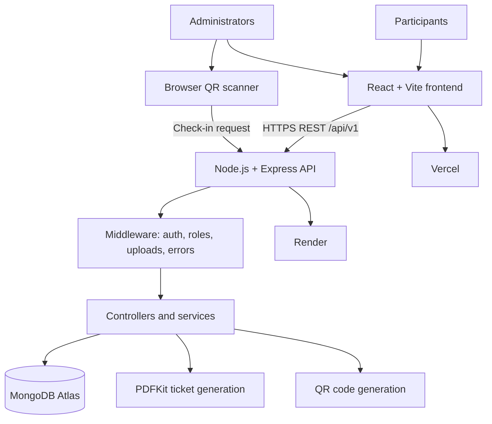

# NextGen Materials — Conference Management Platform

**Live site:** https://next-gen-metallurgy.vercel.app/  
**Backend:** https://nextgen-metallurgy.onrender.com/  
**Repository:** https://github.com/Tanmay-singh12/NextGen-Metallurgy

A full-stack conference management platform for participant registration, digital ticket generation, abstract submission, admin review, and QR-based attendance management.

## Features

### Participant-facing website
- Conference registration form and unique registration ID.
- Downloadable PDF ticket with QR code. The QR payload is the registration ID.
- Abstract submission linked to a registration.
- Contributor names and photographs, abstract document, payment screenshot, transaction ID, mentor, organization, theme and keywords.
- Centralized registration modal opened from the website's registration calls to action.

### Admin portal
- Admin login and protected routes.
- Dashboard and registration management.
- Abstract listing, search/filtering, details and file retrieval.
- Abstract review states: `UNDER_REVIEW`, `APPROVED`, `REJECTED`.
- Rejection reason and review timestamp.
- Camera-based QR attendance scanner.
- Duplicate check-in prevention.
- Attendance listing, search, date filters, statistics and CSV export.

## Technology stack

| Layer | Technologies |
|---|---|
| Frontend | React, Vite, JavaScript/JSX, CSS |
| Routing | React Router DOM |
| HTTP client | Axios |
| Icons | Lucide React |
| QR scanning | html5-qrcode |
| Backend | Node.js, Express 5 |
| Database / ODM | MongoDB Atlas, Mongoose 9 |
| Validation | Zod |
| File uploads | Multer |
| PDF and QR generation | PDFKit, qrcode |
| Admin authentication | jsonwebtoken, bcryptjs |
| Hosting | Vercel (frontend), Render (backend) |
| Version control | Git, GitHub |

Check the current package manifests for exact dependency versions.

## Architecture



## Repository layout

This is a documented overview, not an automatically generated full inventory. See [`docs/PROJECT_STRUCTURE.md`](docs/PROJECT_STRUCTURE.md) and compare it with the current checkout.

```text
NextGen-Metallurgy/
├── frontend/
│   ├── public/
│   ├── src/
│   │   ├── admin/
│   │   ├── App.jsx
│   │   └── ...
│   ├── .env.local
│   └── package.json
├── backend/
│   ├── src/
│   │   ├── config/
│   │   ├── controllers/
│   │   ├── middleware/
│   │   ├── models/
│   │   ├── routes/
│   │   ├── services/
│   │   ├── validators/
│   │   ├── app.js
│   │   └── server.js
│   └── package.json
├── docs/
└── README.md
```

## Local setup

Requirements: Node.js, npm, Git, and access to MongoDB.

```bash
git clone https://github.com/Tanmay-singh12/NextGen-Metallurgy.git
cd NextGen-Metallurgy

cd backend
npm install
# Create backend environment file; see docs/DEVELOPMENT_SETUP.md
npm run dev
```

In a second terminal:

```bash
cd frontend
npm install
# Create frontend/.env.local as shown below
npm run dev
```

Frontend local environment:

```env
VITE_API_BASE_URL=http://localhost:5000/api/v1
```

Production frontend environment:

```env
VITE_API_BASE_URL=https://nextgen-metallurgy.onrender.com/api/v1
```

## Backend environment variables

| Variable | Purpose |
|---|---|
| `PORT` | HTTP port; Render supplies this in production |
| `NODE_ENV` | Runtime environment |
| `MONGO_URI` | MongoDB connection string |
| `CLIENT_URL` | Frontend origin allowed by CORS |
| `JWT_SECRET` | Admin JWT signing/verification secret |
| `JWT_EXPIRES_IN` | Admin token lifetime; deployment used `8h` |

Never commit secrets or real environment values. Do not casually rotate the production JWT secret.

## API overview

API prefix: `/api/v1`.

Known admin route groups: `/admin/auth`, `/admin/registrations`, `/admin/abstracts`, `/admin/abstract-review`, `/admin/attendance`.

Known endpoints:
- `POST /api/v1/admin/attendance/check-in`
- `GET /api/v1/admin/attendance/stats`
- `GET /api/v1/admin/attendance`
- `PATCH /api/v1/admin/abstract-review/:registrationId/approve`
- `PATCH /api/v1/admin/abstract-review/:registrationId/reject`

See [`docs/API_REFERENCE.md`](docs/API_REFERENCE.md). Public registration and abstract paths should be confirmed from the current backend route files rather than guessed.

## Database overview

Main Mongoose models: `Registration`, `AbstractSubmission`, `Admin`, and `Attendance`. See [`docs/DATABASE_SCHEMA.md`](docs/DATABASE_SCHEMA.md).

## Deployment

- Frontend: Vercel — https://next-gen-metallurgy.vercel.app/
- Backend: Render — https://nextgen-metallurgy.onrender.com/
- Database: MongoDB Atlas

See [`docs/DEPLOYMENT.md`](docs/DEPLOYMENT.md).

## Security notes

- Keep credentials in hosting environment settings or ignored local env files.
- Admin endpoints must use authentication and role authorization.
- Passwords are hashed; never store plaintext passwords.
- QR codes identify registrations but are not authorization credentials.
- The backend records check-in time and prevents duplicate attendance.
- Keep admin-only file retrieval protected.

## Documentation index

- [Architecture](docs/ARCHITECTURE.md)
- [Technology stack](docs/TECHNOLOGY_STACK.md)
- [Project structure](docs/PROJECT_STRUCTURE.md)
- [API reference](docs/API_REFERENCE.md)
- [Database schema](docs/DATABASE_SCHEMA.md)
- [Development setup](docs/DEVELOPMENT_SETUP.md)
- [Deployment](docs/DEPLOYMENT.md)

> Documentation maintenance: verify the complete file tree, package versions, and every API path against the current `main` branch before treating this as an exhaustive source-of-truth inventory.
