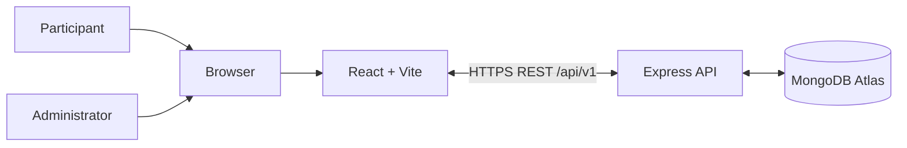
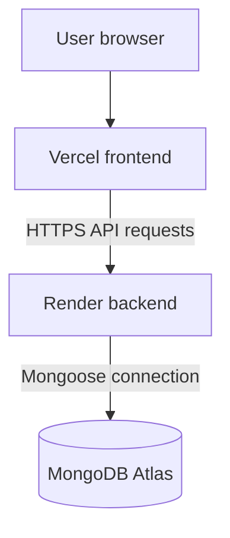
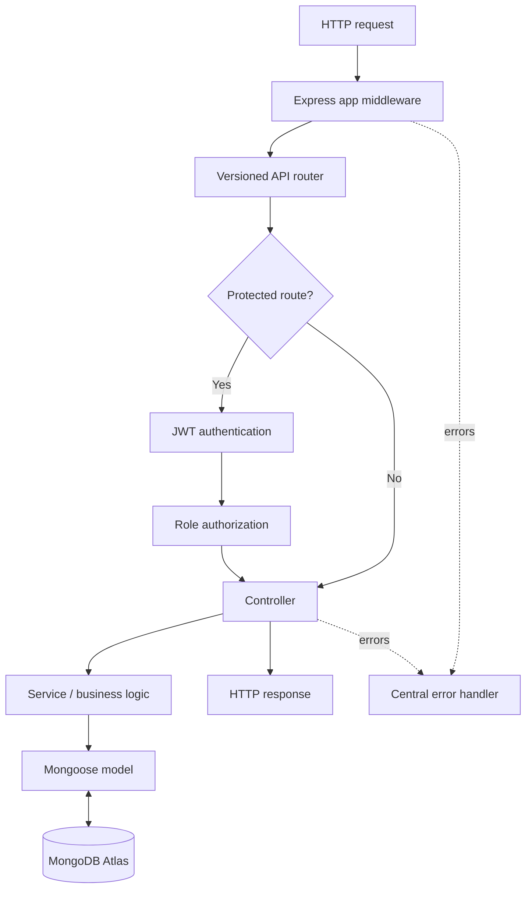
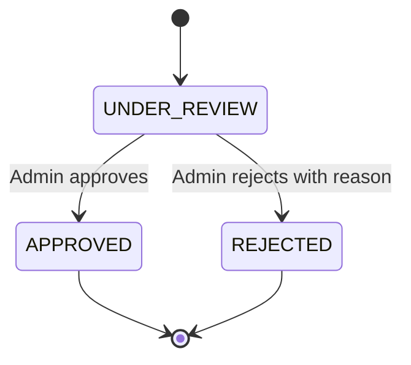
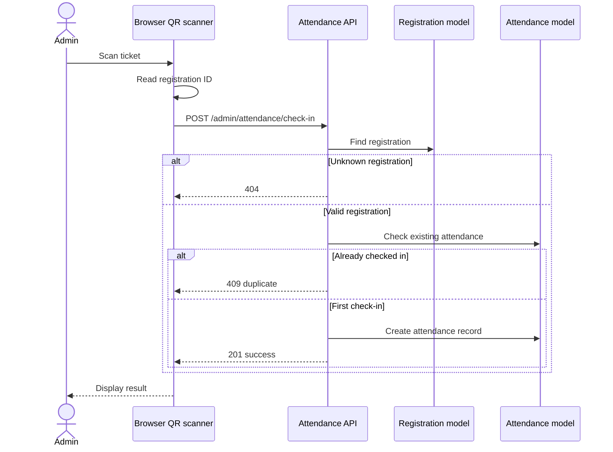

# System Architecture

## 1. Architectural style

The project uses a separated frontend/backend architecture. The frontend is a React single-page application built with Vite. It communicates with a Node.js/Express REST API. The backend persists application data through Mongoose in MongoDB Atlas. The frontend is hosted on Vercel and the API on Render.

## 2. Context and deployment





Production frontend: `https://next-gen-metallurgy.vercel.app/`  
Production backend: `https://nextgen-metallurgy.onrender.com/`  
API prefix: `/api/v1`

## 3. Backend request lifecycle



### Backend responsibilities

| Layer | Responsibility |
|---|---|
| `config/` | Database and application configuration |
| `routes/` | HTTP method/path mapping and middleware attachment |
| `middleware/` | Authentication, roles, uploads, error and not-found handling |
| `controllers/` | Request parsing, invoking business logic, HTTP responses |
| `services/` | Business rules and multi-step operations |
| `models/` | Mongoose schemas, validation and indexes |
| `validators/` | Request validation schemas where used |
| `app.js` | Express middleware and route mounting |
| `server.js` | Database/server startup |

## 4. Frontend architecture

`App.jsx` configures routing and providers. The admin experience uses an authentication context, a protected route that renders nested routes through React Router's `Outlet`, and a dedicated Axios API client. The Axios request interceptor attaches the admin bearer token from `sessionStorage`.

Known admin frontend files:

```text
frontend/src/admin/
├── api.js
├── AdminAuthContext.jsx
├── ProtectedAdminRoute.jsx
├── AdminLogin.jsx
├── AdminDashboard.jsx
├── AbstractManagement.jsx
├── AttendanceScanner.jsx
└── AttendanceDashboard.jsx
```

## 5. Registration and ticket workflow

```mermaid
sequenceDiagram
  actor Participant
  participant UI as React UI
  participant API as Express API
  participant S as Registration/ticket service
  participant DB as MongoDB
  Participant->>UI: Submit registration
  UI->>API: Registration request
  API->>S: Validate/process
  S->>DB: Create or retrieve registration
  DB-->>S: Registration record
  S->>S: Generate PDF ticket and QR
  S-->>API: Registration/ticket result
  API-->>UI: Response or PDF
  UI-->>Participant: Confirmation/download
```

The QR code payload is the registration ID.

## 6. Abstract submission and review

The participant submits abstract metadata and files using a multipart request. Multer handles uploaded files, and the abstract service persists file data and metadata in MongoDB. A new submission has status `UNDER_REVIEW`.



Review endpoints only transition submissions still in `UNDER_REVIEW`. The review timestamp is stored. Rejection stores a reason. Already-reviewed submissions return a conflict response.

## 7. Attendance check-in workflow



Attendance stores a server-generated timestamp and the admin who performed the check-in. A unique registration ID constraint prevents duplicate check-ins.

## 8. Authentication and authorization

- Admin passwords are hashed using `bcryptjs`.
- Admin login uses signed JWTs.
- Backend middleware validates the JWT, issuer and audience, then loads the active admin record.
- The middleware exposes `req.admin.id`, `req.admin.email`, and `req.admin.role`.
- Role middleware restricts access to configured roles.
- The frontend stores the token in `sessionStorage` and attaches it to admin API calls.

**Important implementation contract:** use `req.admin.id` in controllers. The established middleware does not expose `req.admin._id`.

## 9. File handling

Abstract document, contributor photographs and payment screenshot content are stored as MongoDB binary data with file metadata. Admin file retrieval converts stored binary data into a Node.js `Buffer` before sending it. Ticket PDFs are generated using PDFKit; QR codes are generated using `qrcode`.

## 10. Architecture constraints

- Preserve the frontend/backend separation and `/api/v1` API prefix.
- Preserve the ticket QR payload as the registration ID.
- Keep duplicate check-in prevention server-side.
- Keep admin routes protected.
- Keep `req.admin.id` consistent between middleware and controllers.
- Do not rotate the production JWT secret during routine changes.
