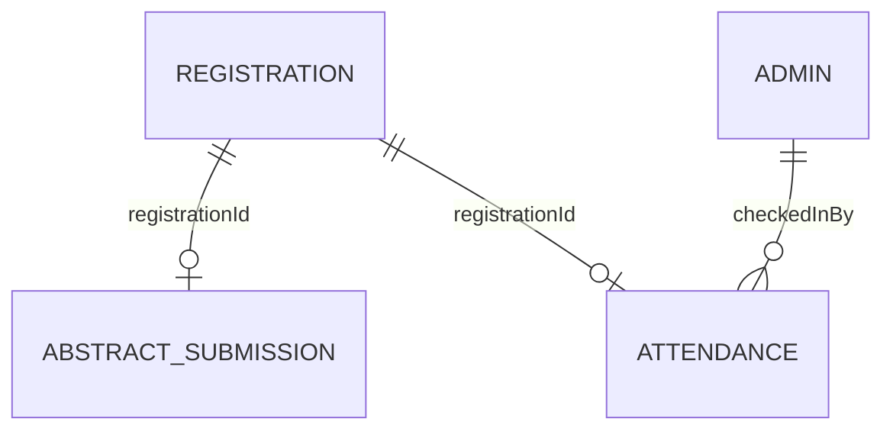

# Database Schema Overview

The application uses MongoDB Atlas through Mongoose. Main domain models are `Registration`, `AbstractSubmission`, `Admin`, and `Attendance`.

This document records known fields and relationships. Confirm exact types, required flags, defaults, indexes and collection names in `backend/src/models/`.

## Relationships

## Registration

Known fields:

| Field | Purpose |
|---|---|
| `name` | Participant name |
| `email` | Email address |
| `mobileNumber` | Contact number |
| `rollNumber` | Roll number |
| `year` | Year of study |
| `department` | Department |
| `registrationId` | Unique registration identifier |
| `createdAt` | Creation timestamp |

Ticket QR payload is the `registrationId`.

## AbstractSubmission

Known fields:

| Field | Purpose |
|---|---|
| `registrationId` | Associated registration |
| `contributorNames` | Contributor names |
| `photos` | Contributor photo binary data and metadata |
| `abstractTitle` | Abstract title |
| `mentorName` | Mentor name |
| `organizationName` | Organization/institute |
| `theme` | Abstract theme |
| `keywords` | Keywords; form requires five |
| `abstractFile` | Uploaded abstract document and metadata |
| `paymentScreenshot` | Payment evidence and metadata |
| `transactionId` | Transaction reference; nullable |
| `status` | Review status |
| `rejectionReason` | Rejection explanation; nullable |
| `reviewedAt` | Review timestamp; nullable |
| timestamps | Mongoose creation/update timestamps |

Theme values:
- `Manufacturing and Process Metallurgy`
- `Characterization`
- `Advanced Materials`
- `Materials Informatics`
- `Non Core`
- `Other`

File content is stored as MongoDB binary data in the current implementation.

## Admin

| Field | Purpose |
|---|---|
| `email` | Unique, lowercase, trimmed email |
| `passwordHash` | Password hash, excluded from ordinary queries by default |
| `role` | `ADMIN` or `SUPER_ADMIN` |
| `isActive` | Account enabled flag |
| `lastLoginAt` | Last login timestamp |

Passwords must never be stored or returned in plaintext.

## Attendance

| Field | Purpose |
|---|---|
| `registrationId` | Unique registration identifier; prevents duplicate check-ins |
| `name` | Participant name snapshot |
| `email` | Participant email snapshot |
| `rollNumber` | Roll number snapshot |
| `department` | Department snapshot |
| `year` | Year snapshot |
| `checkedInAt` | Server-generated check-in time |
| `checkedInBy` | ObjectId reference to the admin |
| timestamps | Mongoose creation/update timestamps |

The authentication middleware exposes the admin identifier as `req.admin.id`; attendance creation uses that value.

## Known constraints and indexes

- Registration ID is the common identifier across registration, ticket QR, abstract association and attendance.
- Attendance registration ID is unique.
- Admin email is unique.
- Abstract review queries use a status/creation-time index in the documented implementation.
- Confirm index declarations in model files before changing them.
