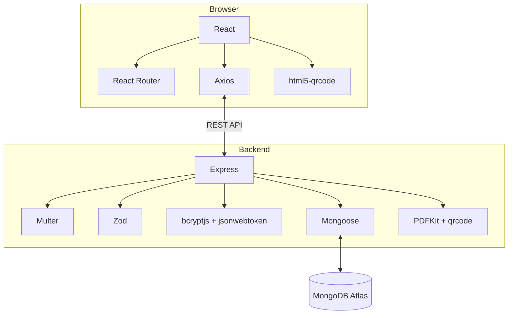

# Technology Stack

| Area | Technology | Purpose |
|---|---|---|
| Frontend | React | Component-based UI |
| Frontend tooling | Vite | Development server and production build |
| Language | JavaScript / JSX | Application implementation |
| Styling | CSS | UI styling |
| Routing | React Router DOM | Client-side and protected routes |
| HTTP | Axios | API requests |
| Icons | Lucide React | Interface icons |
| QR scanner | html5-qrcode | Browser camera QR scanning |
| Runtime | Node.js | Backend JavaScript runtime |
| API framework | Express 5 | REST API and middleware |
| Database | MongoDB Atlas | Hosted document database |
| ODM | Mongoose 9 | Schemas and database access |
| Validation | Zod | Request/data validation where configured |
| Uploads | Multer | Multipart file handling |
| PDF | PDFKit | Conference ticket generation |
| QR generation | qrcode | QR creation for tickets |
| Password hashing | bcryptjs | Admin password hashing |
| Token auth | jsonwebtoken | Admin JWT creation/verification |
| Frontend hosting | Vercel | Production frontend |
| Backend hosting | Render | Production API |
| Version control | Git, GitHub | Source control and deployment integration |
| API testing | Postman | Endpoint testing |

## Technology interaction

Exact installed versions should be read from `frontend/package.json`, `backend/package.json`, and their lockfiles. This document intentionally does not guess patch versions.
